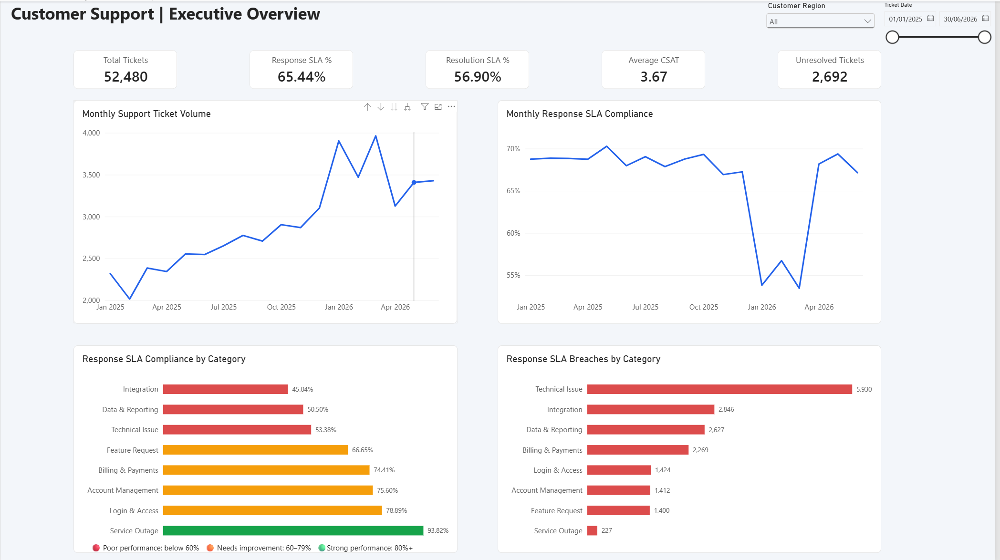
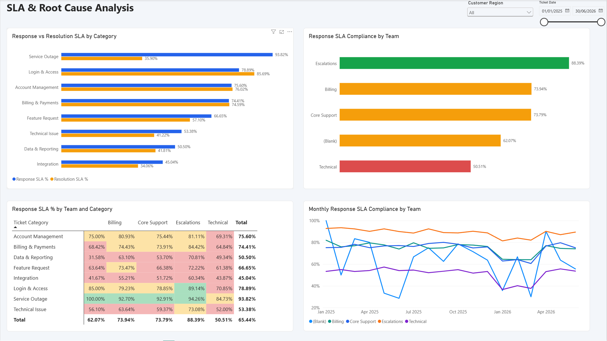
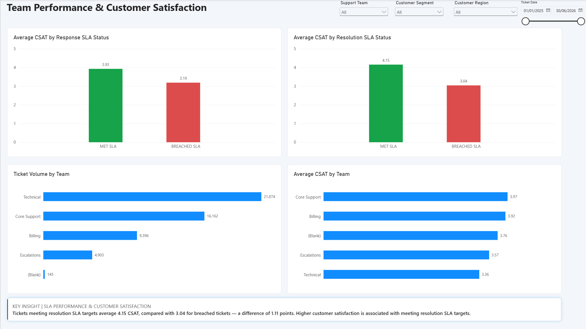

# Customer Support Analytics | SQL Server & Power BI

## Project Overview

This project analyses customer support performance using **SQL Server and Power BI**, focusing on service-level agreement (SLA) compliance, operational efficiency and customer satisfaction.

Using a synthetic dataset of **52,480 support tickets** covering January 2025 to June 2026, I developed an end-to-end analytics solution to identify performance gaps, investigate differences across support teams and ticket categories, and explore the relationship between SLA performance and customer satisfaction.

The project combines SQL-based data preparation and exploratory analysis with an interactive, three-page Power BI dashboard designed to support operational decision-making.

## Tools & Technologies

- **SQL Server / SSMS:** Data cleaning, validation, joins, CTEs, window functions and exploratory analysis
- **Power BI:** Data modelling, DAX measures, interactive dashboards and conditional formatting
- **Power Query:** Data import and type transformations
- **GitHub:** Project documentation and version control

## Dashboard

### 1. Executive Overview



Provides a high-level view of support operations, including ticket volumes, response and resolution SLA compliance, unresolved tickets and customer satisfaction.

### 2. SLA & Root Cause Analysis



Explores performance differences across ticket categories and support teams, including SLA compliance comparisons, breach volumes and monthly trends.

### 3. Team Performance & Customer Satisfaction



Compares team workloads and customer satisfaction, and investigates the association between SLA compliance and CSAT scores.

All three pages include interactive filtering to support further exploration.

## Key Performance Indicators

| KPI | Result |
|---|---:|
| Total Support Tickets | 52,480 |
| Response SLA Compliance | 65.44% |
| Resolution SLA Compliance | 56.90% |
| Average Customer Satisfaction | 3.67 / 5 |
| Unresolved Tickets | 2,692 |
| CSAT Coverage of Resolved Tickets | 57.9% |

## Key Findings

### 1. Technical support represents a major performance improvement opportunity

The Technical team handled **21,874 tickets**, the largest workload of any support team, but achieved only **50.51% response SLA compliance**.

Technical Issues also generated the highest number of response SLA breaches across ticket categories, with **5,930 breaches**.

**Business implication:** Investigate workload distribution, ticket complexity, staffing capacity and escalation processes to identify opportunities to improve response performance.

### 2. Integration and Data & Reporting tickets have consistently low SLA compliance

Integration tickets recorded the lowest response SLA compliance at **45.04%**, followed by Data & Reporting at **50.50%** and Technical Issues at **53.38%**.

These categories may require additional specialist support, improved knowledge resources or revised operational processes.

### 3. Fast initial responses do not always translate into timely resolution

Service Outage tickets achieved **93.82% response SLA compliance**, the highest of all categories, but only **35.90% resolution SLA compliance**.

This suggests that acknowledging incidents promptly does not necessarily mean they are resolved within target times.

**Business implication:** Review incident investigation, escalation and resolution workflows separately from initial response performance.

### 4. SLA performance deteriorated during Q1 2026

Monthly analysis identified a decline in response SLA compliance across multiple support teams during Q1 2026, followed by a recovery beginning in April.

Higher ticket volumes coincided with part of this decline, although the analysis does not establish volume as the sole cause.

**Business implication:** Investigate changes in staffing, ticket mix, operational capacity and service processes during the affected period.

### 5. SLA compliance is associated with higher customer satisfaction

Tickets meeting resolution SLA targets recorded an average CSAT score of **4.15**, compared with **3.04** for tickets that breached their targets.

This represents a difference of **1.11 points** on a five-point scale.

The results indicate an association between timely resolution and customer satisfaction, although they do not establish causation.

## Data Preparation & SQL Methodology

The project combined five relational datasets:

- Tickets
- Customers
- Support Agents
- SLA Targets
- Customer Satisfaction

SQL Server was used to clean and validate the data, join the source tables and calculate operational performance metrics.

Key activities included:

- Identifying and removing 38 duplicate ticket records, reducing the dataset from 52,518 to 52,480 tickets
- Retaining 145 tickets with missing agent assignments
- Identifying 2,692 unresolved tickets and excluding them from resolution SLA compliance calculations
- Handling missing CSAT scores without treating them as zero
- Calculating response and resolution durations using `DATEDIFF`
- Classifying SLA performance using `CASE WHEN`
- Using `GROUP BY`, conditional aggregation and CTEs to analyse performance across categories, teams and time periods
- Creating a reusable SQL view for Power BI reporting

## Data Quality & Limitations

During validation, **1,741 tickets (3.32%)** were identified with resolution timestamps occurring before their recorded first-response timestamps.

These records were retained because the original timestamps could not be reliably corrected without introducing assumptions.

The anomaly does not produce negative creation-to-response or creation-to-resolution durations, but it creates an inconsistent event sequence that may affect the operational interpretation of SLA performance.

Additional limitations include:

- The dataset is synthetic and does not represent actual customer support operations.
- CSAT scores are available for approximately 57.9% of resolved tickets, creating potential response bias.
- Differences between teams and categories may be influenced by ticket complexity and workload.
- Observed relationships between SLA performance and customer satisfaction should not be interpreted as causal.

## Recommendations

Based on the analysis, the following actions would be worth investigating in a real support environment:

1. **Prioritise Technical team performance:** Review workload, staffing, complexity and escalation patterns.
2. **Improve specialist ticket handling:** Investigate recurring delays in Integration, Technical Issues and Data & Reporting.
3. **Review Service Outage resolution workflows:** Identify bottlenecks after initial incident acknowledgement.
4. **Investigate the Q1 2026 performance decline:** Assess changes in demand, capacity and ticket characteristics.
5. **Strengthen data quality controls:** Validate timestamp sequences during ingestion and improve CSAT coverage.

## Repository Structure

```text
customer-support-analytics/
├── sql/
│   ├── 01_data_cleaning.sql
│   ├── 02_exploratory_analysis.sql
│   └── 03_ticket_analysis_view.sql
├── powerbi/
│   └── Customer_Support_Analytics.pbix
├── screenshots/
│   ├── 01_executive_overview.png
│   ├── 02_sla_analysis.png
│   └── 03_team_performance.png
└── README.md
```

## Project Outcome

This project demonstrates an end-to-end analytical workflow, from SQL-based data preparation and quality validation through exploratory analysis and interactive reporting.

The emphasis was on translating operational data into actionable findings, while recognising data-quality limitations and distinguishing observed relationships from proven causes.
